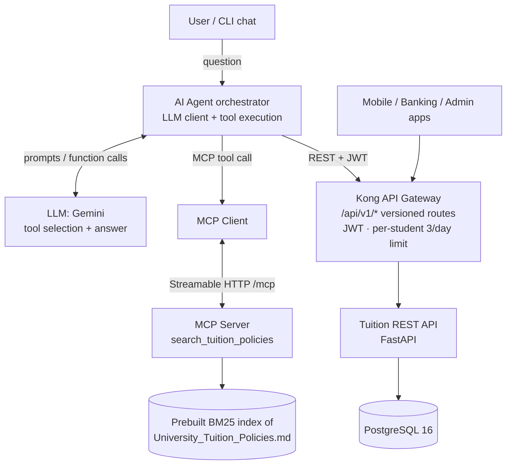
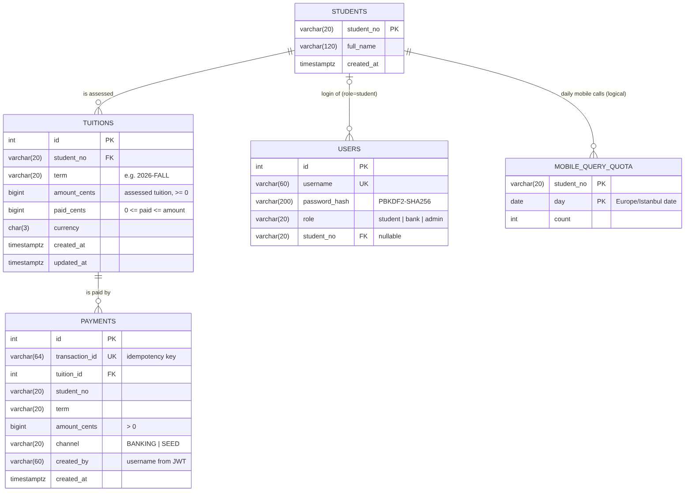

# SE 4458 Midterm 1 — AI Tuition Assistant (Group 1)

**Student:** Tibet Derebağ (Student No: `23070006024`)  ·  **Repository:** https://github.com/derebagtibet/se4458-tuition-assistant  ·  **Demo video:** https://www.youtube.com/watch?v=_DnmhyPsTmE  ·  **Course:** SE 4458 Software Architecture & Design of Modern Large Scale Systems

An integrated system with the four mandatory components:

1. **AI Agent** (Python): an LLM (Google Gemini) picks tools through **real function calling**, and the agent runs them.
2. **MCP Server** (official MCP Python SDK): indexed search over `University_Tuition_Policies.md`, exposed as the tool `search_tuition_policies(query)`.
3. **Tuition REST API** (FastAPI) with a **PostgreSQL** server database, JWT auth and Swagger UI.
4. **API Gateway** (Kong 3.9, DB-less). **Every** REST call goes through it, including the agent's calls.

> Deployed URLs, the demo video and screenshots: see [Deployed URLs](#9-cloud-deployment-azure) and [Evidence](#12-evidence-checklist).

**Verification on 21 November 2026:** local PostgreSQL, REST API, Kong and MCP are running and verified. The automated suites contain **82 tests**; execution evidence is in [`docs/evidence/unit-tests.log`](docs/evidence/unit-tests.log). Real gateway checks (401/200/403/429, payments, duplicates, CSV and paging) are in [`docs/evidence/gateway-demo.log`](docs/evidence/gateway-demo.log); three real MCP retrieval queries are in [`docs/evidence/mcp-retrieval-demo.log`](docs/evidence/mcp-retrieval-demo.log).

**Live Gemini verification:** after funding the project, generation succeeded with `gemini-3.8-flash`. The previous `gemini-flash-latest` alias returned HTTP 404, and the provider rejected `gemini-2.5-flash` for new users, so the configured/default model was updated. All three real agent scenarios passed: [MCP-only](docs/evidence/agent-mcp-only.log), [REST-only](docs/evidence/agent-rest-only.log), and [combined MCP + REST](docs/evidence/agent-combined.log). A [student-confirmed simulated payment](docs/evidence/agent-payment-confirmed.log) through the agent also succeeded (confirmation prompt → `yes` → Pay API via Kong → `SUCCESS`, 2026-FALL balance 3000 → 2500 USD). Complete JSON tool traces are in [`docs/evidence/agent/`](docs/evidence/agent/); the credential-free connection check is in [`gemini-key-check.log`](docs/evidence/gemini-key-check.log).

**Cloud deployment:** live on Azure. Gateway https://kong-gateway.proudmeadow-f5ce4b7c.swedencentral.azurecontainerapps.io · MCP https://mcp-server.proudmeadow-f5ce4b7c.swedencentral.azurecontainerapps.io/mcp (see [§9](#9-cloud-deployment-azure)).

**Cloud evidence:** the full gateway check (`Overall result: PASSED`), three MCP retrieval queries and the agent demo (including a confirmed payment) were re-run against the Azure URLs: [`cloud-gateway-demo.log`](docs/evidence/cloud-gateway-demo.log), [`cloud-mcp-retrieval-demo.log`](docs/evidence/cloud-mcp-retrieval-demo.log), [`cloud-agent-demo.log`](docs/evidence/cloud-agent-demo.log), and the combined MCP + REST scenario in a fresh session: [`cloud-agent-combined.log`](docs/evidence/cloud-agent-combined.log).

**Demo video (9.5 min):** https://www.youtube.com/watch?v=_DnmhyPsTmE: architecture, Swagger, gateway checks (401/200/403/429/409), three MCP retrieval tests, the three agent scenarios, a confirmed simulated payment, the authorization guard and the unit-test run, all against the Azure deployment.

---

## 1. Architecture



Rendered image: [`docs/diagrams/arch.png`](docs/diagrams/arch.png)

* The **MCP path** (agent → MCP client → MCP server) is separate from the **gateway path** (agent → Kong → REST API → DB).
* The LLM never calls a backend. It only returns function calls, and the agent executes them and sends the results back (`automatic_function_calling` is disabled).
* The policy document is indexed **once**, during the MCP Docker build (`policy_index.json`). It is loaded at start-up and never re-indexed per question.

### Repository layout

| Path | What |
|---|---|
| `services/tuition_api/` | FastAPI REST API, SQLAlchemy models, JWT auth, unit tests |
| `services/mcp_server/` | MCP server (`server.py`), chunker + BM25 index (`policy_search/indexer.py`), tests |
| `gateway/kong/` | Kong declarative config template (`kong.yml.tpl`), Dockerfile |
| `agent/` | AI agent (`tuition_agent/agent.py`), Gemini adapter, MCP/REST clients, CLI, tests |
| `data/` | Policy document, sample batch CSV |
| `docs/` | `openapi.json` (OpenAPI 3.1), `ER.md` + `diagrams/er.png`, `mcp_tool_schema.json`, `evidence/` |
| `deploy/azure/deploy.sh` | One-shot Azure deployment |
| `scripts/` | `run_tests.py` (all suites + saved log), `gateway_demo.py` (real gateway checks + saved log), `.sh` alternatives, `mcp_demo.py` (3 retrieval queries over MCP) |

---

## 2. Quick start (local)

Requirements: Docker + Docker Compose, Python 3.11+, and a Gemini API key for a project with available quota (https://aistudio.google.com/apikey).

```bash
cp .env.example .env            # set JWT_SECRET (openssl rand -hex 32) and GEMINI_API_KEY
docker compose up --build -d    # postgres, tuition-api, mcp-server, kong
curl http://localhost:8000/api/v1/mobile/tuition/S1001     # through the gateway
open http://localhost:8000/api/docs                        # Swagger UI (through the gateway)
bash scripts/gateway_demo.sh                               # gateway walkthrough (401 / 200 / 429 / 409 ...)

# AI agent (CLI)
cd agent && pip install -r requirements.txt
export GEMINI_API_KEY=...   # GATEWAY_URL defaults to localhost:8000; MCP_URL to localhost:${MCP_HOST_PORT:-8001}/mcp
python -m tuition_agent.cli --username s1001 --demo        # runs the 5 demo scenarios
python -m tuition_agent.cli --username s1001               # interactive chat
```

The CLI and Python demo scripts load the project `.env` without overriding environment variables. `MCP_URL` overrides the local URL; otherwise they use `MCP_HOST_PORT` (default `8001`, currently `8002` in this checkout). The current local MCP endpoint is `http://localhost:8002/mcp`. Replace the example `JWT_SECRET` with a random value before sharing or deploying the stack.

Windows PowerShell, from the project root (Python already installed):

```powershell
uv venv --python 3.13 .venv
uv pip install --python .venv/Scripts/python.exe -r services/tuition_api/requirements-dev.txt -r services/mcp_server/requirements-dev.txt -r agent/requirements-dev.txt
.\.venv\Scripts\Activate.ps1
docker compose up --build -d
python scripts/run_tests.py
python scripts/gateway_demo.py
python scripts/mcp_demo.py
cd agent
python -m tuition_agent.cli --username s1001 --demo
```

`gateway_demo.py` creates a fresh `DEMO...` student and simulated payment, so repeated runs have independent daily quotas. Its direct payment check does not demonstrate an agent asking a student for confirmation.

**Demo users** (seeded on start-up, see `app/seed.py`):

| Username | Password | Role | Data |
|---|---|---|---|
| `s1001` | `Passw0rd!` | student S1001 | 2026-FALL 3000 USD unpaid, 2027-SPRING 3000 USD unpaid |
| `s1002` | `Passw0rd!` | student S1002 | 2026-FALL 4500, paid 1500 |
| `s1003` … `s1005` | `Passw0rd!` | students | S1003 fully paid, S1004 250 (below installment minimum), S1005 3750/1000 |
| `bankapp` | `Bank123!` | bank | Banking-app service account (may act for any student) |
| `admin` | `Admin123!` | admin | Admin web-site operations |

---

## 3. REST API (v1)

Swagger UI: `<gateway>/api/docs` · OpenAPI file: [`docs/openapi.json`](docs/openapi.json). All bodies are JSON with camelCase fields. Errors always use the same shape:
`{"error": {"code": "AMOUNT_EXCEEDS_BALANCE", "message": "...", "details": {...}}}`.

| Client | Operation | Method & route | Auth | Paging | Notes |
|---|---|---|---|---|---|
| — | Login | `POST /api/v1/auth/token` | – | – | Returns a JWT (HS256, 60 min) with claims `sub`, `role`, `studentNo`, `iss`, `exp` |
| University Mobile App | Query Tuition | `GET /api/v1/mobile/tuition/{studentNo}?term=` | **NO** | NO | **3 calls per student per day** (gateway + API) |
| Banking App | Query Tuition | `GET /api/v1/banking/tuition/{studentNo}?term=` | **YES** | NO | Students: own account only |
| Banking App | Pay Tuition | `POST /api/v1/banking/payments` | **YES** | NO | `{studentNo, term, amount, transactionId}` → status, paid amount, remaining balance |
| Admin | Add Tuition | `POST /api/v1/admin/tuition` | **YES** (admin) | NO | Create or update `{studentNo, term, amount, currency}` |
| Admin | Add Tuition – Batch | `POST /api/v1/admin/tuition/batch` (multipart `file`) | **YES** (admin) | NO | CSV `studentNo,term,amount,currency`; returns success/failure counts and per-row results |
| Admin | Unpaid Tuition Status | `GET /api/v1/admin/tuition/unpaid?term=&page=&pageSize=` | **YES** (admin) | **YES** | Sorted by balance desc; `pageSize` ≤ 100 |

**Term vs overall balance (API contract):** if `term` is given, `scope = "TERM"` and the totals cover that term only. Without it, `scope = "OVERALL"` and the totals are summed over all terms, with a per-term breakdown in `terms[]`.

**Error codes** (HTTP status → `error.code`)

| HTTP | `error.code` | When |
|---|---|---|
| 400 | `INVALID_CSV` | Batch file not UTF-8 or header ≠ `studentNo,term,amount,currency` |
| 401 | `UNAUTHORIZED` / `INVALID_TOKEN` / `TOKEN_EXPIRED` | Missing, forged or expired JWT (Kong answers `{"message":"Unauthorized"}` before the API) |
| 401 | `INVALID_CREDENTIALS` | Wrong username/password at `/auth/token` |
| 403 | `FORBIDDEN` | Wrong role, or a student accessing another student's account |
| 404 | `STUDENT_NOT_FOUND` / `TERM_NOT_FOUND` | Unknown student, or no tuition for that term |
| 409 | `DUPLICATE_TRANSACTION` | `transactionId` already used; nothing charged |
| 409 | `AMOUNT_BELOW_PAID` / `CURRENCY_MISMATCH` | Add Tuition would make the balance negative or mix currencies |
| 413 | `PAYLOAD_TOO_LARGE` | Batch CSV > 1 MB |
| 422 | `VALIDATION_ERROR` | Bad term/studentNo format, amount ≤ 0 or > 2 decimals, pageSize > 100 … (`details` lists fields) |
| 422 | `AMOUNT_EXCEEDS_BALANCE` | Payment larger than the outstanding term balance |
| 429 | `DAILY_LIMIT_EXCEEDED` | 4th mobile Query Tuition for the same student on the same day (`Retry-After` header) |

**Business rules**

* **Pay Tuition:** the amount must be > 0, have at most 2 decimals and be ≤ the current term balance (`422 AMOUNT_EXCEEDS_BALANCE`). `transactionId` is an idempotency key: a reused ID is rejected with `409 DUPLICATE_TRANSACTION` and nothing is charged twice (a UNIQUE constraint also covers races). Partial and full payments are both supported, and the payment is simulated (no card processing).
* **Add Tuition duplicate handling** (per `(studentNo, term)`):
  * new → `201 CREATED`
  * same amount → `200 UNCHANGED` (idempotent)
  * different amount → `200 UPDATED`
  * new amount below the already-paid amount → `409 AMOUNT_BELOW_PAID`
  * a student keeps a single currency → `409 CURRENCY_MISMATCH`
  * an unknown student is created automatically.
* **Batch:** each row goes through the same validation contract as Add Tuition and its own savepoint, so bad rows never roll back good rows. Non-finite/oversized amounts and rows with missing/extra columns are reported as failures. Malformed CSV quoting is rejected before any writes. Within one file, later rows for the same `(studentNo, term)` update earlier ones. The header must be exact. Files are limited to 1 MB (API and gateway).
* **Versioning:** the version is in the URI (`/api/v1/...`). The routers live in `app/api/v1/`. A breaking change goes into `app/api/v2/` mounted at `/api/v2` next to v1, plus a new Kong route, so existing clients keep working.

---

## 4. API Gateway (Kong)

* **Gateway URL:** `http://localhost:8000` (local) · `https://<kong-gateway FQDN>` (Azure, see §9)
* Config: [`gateway/kong/kong.yml.tpl`](gateway/kong/kong.yml.tpl). This is DB-less, declarative config rendered from environment variables at start-up. The Tuition API itself is **not** published (Compose: no host port; Azure: *internal* ingress), so it is reachable only through Kong.

| Kong route | Public path(s) | Methods | Upstream | Protection |
|---|---|---|---|---|
| `auth-v1` | `/api/v1/auth` | POST | tuition-api | public |
| `api-docs` | `/api/docs`, `/api/openapi.json` | GET | tuition-api | public |
| `mobile-tuition-v1` | `/api/v1/mobile/tuition/{studentNo}` | GET | tuition-api | public + **per-student 3/day counter** (`pre-function`) |
| `banking-v1` | `/api/v1/banking/*` | GET, POST | tuition-api | **JWT plugin** (signature + `exp`) |
| `admin-v1` | `/api/v1/admin/*` | GET, POST | tuition-api | **JWT plugin** + 1 MB request-size limit |
| global | all | | | `correlation-id` (X-Request-ID), per-IP 120 req/min |

**Authentication.** The API's `/auth/token` endpoint issues tokens with `iss = tuition-auth`, and Kong's JWT consumer uses that same key and shared secret. Kong rejects missing, forged or expired tokens before they reach the service. The API then checks the token again and enforces **authorization**: role (student, bank or admin) and ownership (a student can only access their own `studentNo`).

**3 queries per student per day.** Kong's stock `rate-limiting` plugin can only key by consumer, IP, header or a single fixed path. So the mobile route uses a small `pre-function` that keys a counter by the **student number in the path** plus the **Europe/Istanbul date**. It uses Kong's shared counter dictionary and returns `429` with `Retry-After` on the 4th call. Different students coming from the same IP are counted separately. The API keeps the same counter in PostgreSQL (`mobile_query_quota`) as defence in depth. Kong runs as a single replica, which keeps its in-memory counter consistent.

**Error response examples (through the gateway)**

```http
GET /api/v1/banking/tuition/S1001          (no token)
HTTP/1.1 401 Unauthorized                   {"message":"Unauthorized"}

GET /api/v1/mobile/tuition/S1004           (4th call today)
HTTP/1.1 429 Too Many Requests   Retry-After: 41234   X-RateLimit-Remaining-Student-Day: 0
{"error":{"code":"DAILY_LIMIT_EXCEEDED","source":"api-gateway","message":"Query Tuition is limited to 3 calls per student per day","details":{"studentNo":"S1004","day":"2026-11-19"}}}

GET /api/v1/banking/tuition/S1002          (token of s1001)
HTTP/1.1 403 Forbidden                      {"error":{"code":"FORBIDDEN","message":"You are not authorized to access this student's account"}}
```

---

## 5. Data model

PostgreSQL 16 (Azure Database for PostgreSQL Flexible Server in the cloud). ER diagram: **[docs/diagrams/er.png](docs/diagrams/er.png)**; Mermaid source and constraints: **[docs/ER.md](docs/ER.md)**.


 Tables: `students`, `tuitions`, `payments`, `users`, `mobile_query_quota`. Money is stored as integer cents. Tables are created on start-up (`create_all`) and demo data is seeded idempotently.

---

## 6. MCP server and indexing

* **SDK:** official `mcp` Python SDK (FastMCP), Streamable HTTP transport at `http://<host>:8001/mcp` (`MCP_TRANSPORT=stdio` is also supported). Health check: `/health`.
* **Tool schema** (as reported by the server's `tools/list`, full file: [`docs/mcp_tool_schema.json`](docs/mcp_tool_schema.json))

```json
{
  "name": "search_tuition_policies",
  "inputSchema": {
    "type": "object",
    "properties": {
      "query": {"title": "Query", "type": "string"},
      "top_k": {"title": "Top K", "type": "integer", "default": 3}
    },
    "required": ["query"]
  }
}
```

Result: `{"document": "University_Tuition_Policies.md", "documentId": "UNI-TUITION-2026-01", "query": "...", "matches": [{"section": "3.2", "heading": "Number and size of installments", "parentSection": "3. Installment policy", "text": "...", "score": 4.27}]}`. The server also exposes the resource `policy://tuition/document`.

* **Indexing approach** (`policy_search/indexer.py`):
  * **Chunking:** one chunk per `###` subsection, so every chunk carries its section ID (e.g. `3.2`). Text directly under a `##` heading (§1, §9) and the preamble become their own chunks. The result is 26 chunks.
  * **Full-text index:** two-field Okapi BM25 (k1 = 1.5, b = 0.75). One score is computed over the chunk body and one over its title (subsection heading + parent section title), combined as `body + 1.5 × title`. Titles say what a chunk is *about*: for example, §2.1 mentions "installment arrangement" but is about the Fall deadline. The index uses a light stemmer, stop-words and a small domain synonym list (e.g. *due → deadline*, *shows up → appear/posting*). FAQ chunks are slightly down-weighted in favour of the normative sections. There are no embeddings, which the assignment allows. Results below a minimum score are dropped, so off-topic queries return nothing.
  * **Built once:** `python -m policy_search.indexer build ...` runs during `docker build` and writes `policy_index.json`. The server loads it at start-up.
* **Three (+) distinct retrieval tests** (`services/mcp_server/tests/test_policy_search.py`):

| Query | Top section |
|---|---|
| "When is the Fall payment deadline?" | §2.1 Fall term |
| "Can I pay my outstanding balance in installments?" | §8.2 FAQ, §3.4, §3.2 installments |
| "what is the late fee" | §4.1 Late fee rule (2%) |
| "refund if I withdraw early" | §6.1 Early withdrawal |
| "how long until my payment shows up" | §2.3 Payment posting (via synonym) |
| "pizza recipe with mozzarella" | *(no match)* |

The same three queries can be run against a running or deployed server over the real MCP protocol with `python scripts/mcp_demo.py [<mcp-url>]`. Sample output: [`docs/evidence/mcp-retrieval-demo.log`](docs/evidence/mcp-retrieval-demo.log).

---

## 7. AI agent

`agent/tuition_agent/agent.py`. LLM: **Gemini** (`GEMINI_MODEL`, default `gemini-3.8-flash`) through `google-genai` function calling. This model was verified with the real provider in this checkout.

**Tools given to the LLM**

| Tool | Executes | Path |
|---|---|---|
| `search_tuition_policies(query)` | MCP `search_tuition_policies` | MCP client → MCP server |
| `get_my_tuition(term?)` | `GET /api/v1/banking/tuition/{loggedInStudent}` | REST via Kong (JWT) |
| `pay_tuition(term, amount)` | `POST /api/v1/banking/payments`, but only after explicit confirmation | REST via Kong (JWT) |

**Workflow:** user question → LLM tool selection → agent executes MCP and/or REST calls → results returned to the LLM → grounded answer with policy references such as "(Policy §3.2)". The loop allows up to 6 tool steps.

**Safety rules (enforced in code, not only in the prompt)**

* **Identity:** the student logs in through the gateway, and the agent uses *that* JWT. None of the tools has a `studentNo` parameter, so a student number written in the prompt ("show S1002's balance") cannot change whose data is read. If a request were forged anyway, the gateway and API would return 401/403.
* **Payment confirmation:** when the LLM calls `pay_tuition`, the agent validates the term and amount (finite, positive, at most two decimal places; never silently rounded), then reads the live balance. It shows the student, term, amount, current balance and balance after payment, and waits for explicit confirmation (`yes`/`y`/`evet`/`e`). The Pay API is called only after that confirmation, with a fresh idempotency key (`transactionId`). If the student declines, or the amount exceeds the balance, nothing is submitted. A success message is shown only when the API returns `SUCCESS`.
* **Tool trace:** every question is saved as JSON in `traces/` (tool names, inputs, HTTP request, results, timing, confirmation and final answer) and printed in the CLI.

**Demo scenarios** (`python -m tuition_agent.cli --demo`)

| # | Question | Expected tools |
|---|---|---|
| 1 | When is the payment deadline for the Fall term? | MCP only |
| 2 | What is my balance? | REST only |
| 3 | Can I pay my outstanding balance in installments? | REST + MCP |
| 4 | Pay 500 dollars of my 2026-FALL balance. | REST (balance) → confirmation → Pay API |
| 5 | What is the balance of student S1002? | refused / own data only |

**LLM cost.** Token usage is measured, not estimated: the CLI adds up Gemini's `usage_metadata` (prompt tokens, plus answer and thinking tokens, which are billed as output) and prints it at the end of each session. Measured on the four live scenarios in `docs/evidence/`, priced at the published `gemini-3.8-flash` paid-tier rate (USD 0.75 per 1M input / USD 3.75 per 1M output tokens, introductory until 31 Dec 2026; USD 1.50 / USD 7.50 from 1 Jan 2027, see https://ai.google.dev/pricing):

| Scenario | Input tokens | Output tokens | Cost (intro rate) | Cost (from Jan 2027) |
|---|---:|---:|---:|---:|
| MCP-only | 1,981 | 295 | ≈ USD 0.0026 | ≈ USD 0.0052 |
| REST-only | 1,729 | 283 | ≈ USD 0.0024 | ≈ USD 0.0047 |
| MCP + REST combined | 2,164 | 654 | ≈ USD 0.0041 | ≈ USD 0.0082 |
| Confirmed payment | 1,839 | 458 | ≈ USD 0.0031 | ≈ USD 0.0062 |
| **Total (4 scenarios)** | **7,713** | **1,690** | **≈ USD 0.012** | **≈ USD 0.024** |

So one question costs well under one US cent, and running the full five-question `--demo` several times while grading stays below USD 0.10. Source: the `LLM tokens this session` line at the end of each `agent-*.log`.

**Low-cost / testable approach:**
* All 82 automated tests use `ScriptedLLM` or a fake Gemini client, so they need **no** API key and make **no** paid calls.
* Live runs use a Flash-class model, a short system prompt, at most 6 tool steps per question and MCP results capped at `top_k = 3` excerpts, which keeps prompts at about 2k tokens.
* The free Gemini tier can also be used for a few demo questions (`GEMINI_MODEL` selects the model). An initial HTTP 402 credit error was resolved after funding the project. The CLI reports credit, quota, permission and model errors without a traceback.

---

## 8. Unit tests

All REST operations have success **and** failure/edge-case tests. The MCP indexing and retrieval code and the agent orchestration (scripted LLM, fake MCP, mocked gateway) are tested too. **No cloud, gateway, PostgreSQL or live LLM is required**: the API tests use the same SQLAlchemy models on in-memory SQLite as a test double, and PostgreSQL remains the deployment database.

```bash
pip install -r services/tuition_api/requirements-dev.txt -r services/mcp_server/requirements-dev.txt -r agent/requirements-dev.txt
python scripts/run_tests.py       # Windows/Linux; saves docs/evidence/unit-tests.log
# bash scripts/run_tests.sh       # equivalent wrapper
```

The runner uses workspace-local temporary folders, avoiding Windows shared-temp permission errors. Policy index and agent trace files are read/written explicitly as UTF-8.

| Suite | Tests | Covers |
|---|---|---|
| `services/tuition_api` | 42 | auth, mobile query (+3/day limit), banking query (+401/403/expired), pay (partial/full/duplicate/over-balance/invalid + duplicate error privacy), add tuition (create/update/unchanged/conflicts), malformed/non-finite CSV, unpaid paging |
| `services/mcp_server` | 11 | chunking, tokenizer, 5 retrieval queries + no-match, index persistence, MCP tool registration and call |
| `agent` | 29 | MCP-only, REST-only, combined, prompt-supplied student number ignored, payment confirm/decline/over-balance/invalid precision and term, step limit, UTF-8 traces, Gemini request building and provider errors |

Evidence (latest run, full verbose log in [`docs/evidence/unit-tests.log`](docs/evidence/unit-tests.log)):

```
================ services/tuition_api ================   42 passed
================ services/mcp_server  ================   11 passed
================ agent                ================   29 passed
```

---

## 9. Cloud deployment (Azure)

`bash deploy/azure/deploy.sh` (needs the Azure CLI and `az login`; an *Azure for Students* subscription is enough). The script creates:

| Component | Azure service |
|---|---|
| Kong API Gateway | Container Apps (`kong-gateway`, external ingress, 1 replica) |
| Tuition REST API | Container Apps (`tuition-api`, **internal** ingress, scale 0–1) |
| MCP server | Container Apps (`mcp-server`, external ingress, scale 0–1) |
| Server database | Azure Database for PostgreSQL Flexible Server 16 (Burstable B1ms) |
| Images | Azure Container Registry (Basic), built in the cloud with `az acr build` |

**Deployed URLs** (Azure for Students, deployed 21 November 2026)

* API Gateway (Kong): https://kong-gateway.proudmeadow-f5ce4b7c.swedencentral.azurecontainerapps.io
* Swagger UI (through the gateway): https://kong-gateway.proudmeadow-f5ce4b7c.swedencentral.azurecontainerapps.io/api/docs
* OpenAPI JSON: https://kong-gateway.proudmeadow-f5ce4b7c.swedencentral.azurecontainerapps.io/api/openapi.json
* MCP endpoint (Streamable HTTP): https://mcp-server.proudmeadow-f5ce4b7c.swedencentral.azurecontainerapps.io/mcp · health: https://mcp-server.proudmeadow-f5ce4b7c.swedencentral.azurecontainerapps.io/health
* PostgreSQL: `se4458tuition619-pg.postgres.database.azure.com` (database `tuition`, not publicly reachable except from Azure services)
* The Tuition API itself has **internal** ingress only (`tuition-api.internal.…`), so it is reachable only through Kong.

**Regions.** Container Apps run in **Sweden Central** and PostgreSQL in **West Europe**: on this student subscription the Container Apps environment could not be provisioned in West Europe. The script tries a list of regions for both (`ENV_LOCATION` / `PG_LOCATION` override it).

**Cold start.** `tuition-api` and `mcp-server` scale to zero when idle to save credit, so the first request after a quiet period can take about 30–45 s; later requests are fast. Kong runs one fixed replica (its per-student counter is in memory).

**Deployment script notes** (Windows + Git Bash): images are built in ACR without streaming logs (the Azure CLI crashes printing build logs in a cp1254 console), `\r` is stripped from `az -o tsv` output, and every step is idempotent, so the script can simply be re-run after a failure.

Approximate cost: about $13–15/month for PostgreSQL B1ms and about $5/month for ACR Basic. The Container Apps consumption plan stays mostly within the monthly free grant. Check these with the Azure pricing calculator, and run `az group delete -n se4458-tuition-rg` after grading.

---

## 10. Assumptions

* **Identity:** demo users are seeded and passwords are stored as PBKDF2-SHA256 hashes. Tokens are HS256 JWTs whose secret is shared by the API (issuer) and Kong (verifier). In production a real IdP (OAuth 2.0 / OIDC) would issue them.
* **Roles:** `student` can only read and pay their own account. `bank` (the banking app's server account) can query and pay for any student. `admin` handles admin operations and can read any account, but cannot make payments.
* **Mobile query** is unauthenticated, as the spec says, and limited to 3 calls per student per Europe/Istanbul calendar day. Every call counts, including failed lookups. The agent never uses this endpoint, because it uses the authenticated banking query.
* **Money:** amounts have 2 decimals and are stored as integer cents with no rounding. Overpayment is not supported (Policy §7.2). Each student has a single currency (USD in the seed data).
* **Terms** use the format `YYYY-FALL|SPRING|SUMMER`, and the API upper-cases inputs.
* **Policy interpretation:** the assistant explains installment rules but never approves installments (Policy §3.4). Late fees and scholarships are explained but not computed or posted (Policy §4.1, §5.2).
* **Policy document vs database:** the policy markdown is only searched through MCP. Live balances come only from the REST API.
* **MCP security:** the MCP server serves a public, read-only policy document, so it has no auth, and DNS-rebinding protection is disabled for the cloud host name.
* **Gateway counters** are in memory in a single Kong node. Scaling Kong out would need the `redis` policy.

## 11. Reproduce (instructor)

Against the deployed Azure stack, from Git Bash in the project root: `bash scripts/cloud_evidence.sh` (gateway checks, MCP retrieval and the 5-question agent demo; `gateway`, `mcp`, `agent` or `combined` runs a single step). The steps below work for a local stack too.


1. Run `docker compose up --build -d`, or use the deployed gateway URL.
2. Run `GATEWAY_URL=<gateway> bash scripts/gateway_demo.sh`. This shows the public route, the protected route (401, then 200 with a JWT), the 403 cross-student check, the 429 on the 4th mobile call, a payment plus a duplicate (409), and the batch upload with paging. Test data: `data/sample_tuition_batch.csv` (3 valid rows and 3 invalid ones).
3. Run `GATEWAY_URL=<gateway> MCP_URL=<mcp>/mcp GEMINI_API_KEY=<key> python -m tuition_agent.cli --username s1001 --demo` from `agent/` (password `Passw0rd!`) and answer `yes` at the payment confirmation.
4. Run `python scripts/mcp_demo.py <mcp>/mcp` for the three MCP retrieval queries.
5. Run `bash scripts/run_tests.sh`.

## 12. Evidence checklist

Logs and their verification status are in [`docs/evidence/README.md`](docs/evidence/README.md). **Video:** https://www.youtube.com/watch?v=_DnmhyPsTmE. Three live-LLM read scenarios and the student-confirmed simulated payment have been verified.

- [x] Agent scenario 1: MCP-only (real Gemini + MCP; trace + answer)
- [x] Agent scenario 2: REST-only (real Gemini + gateway + PostgreSQL)
- [x] Agent scenario 3: MCP + REST combined (real Gemini; both tools + grounded answer; local and Azure: [`cloud-agent-combined.log`](docs/evidence/cloud-agent-combined.log))
- [x] Confirmed simulated payment (confirmation prompt + `SUCCESS`): [`agent-payment-confirmed.log`](docs/evidence/agent-payment-confirmed.log)
- [x] Three MCP retrieval tests (local MCP server, pytest and the Azure MCP server: [`cloud-mcp-retrieval-demo.log`](docs/evidence/cloud-mcp-retrieval-demo.log))
- [x] Protected gateway route: 401 without a token, 200 with one; 403 cross-student; 429 on the 4th mobile call (local and Azure: [`cloud-gateway-demo.log`](docs/evidence/cloud-gateway-demo.log))
- [x] Unit test run (82 tests, no live LLM)
- [x] Swagger UI through the gateway (HTTP 200, local and Azure)
- [x] Cloud deployment and actual Gateway/Swagger/MCP URLs (see [§9](#9-cloud-deployment-azure)); agent demo against the cloud: [`cloud-agent-demo.log`](docs/evidence/cloud-agent-demo.log)
- [x] Short demonstration video and its link: https://www.youtube.com/watch?v=_DnmhyPsTmE
- [x] GitHub repository publication: https://github.com/derebagtibet/se4458-tuition-assistant
