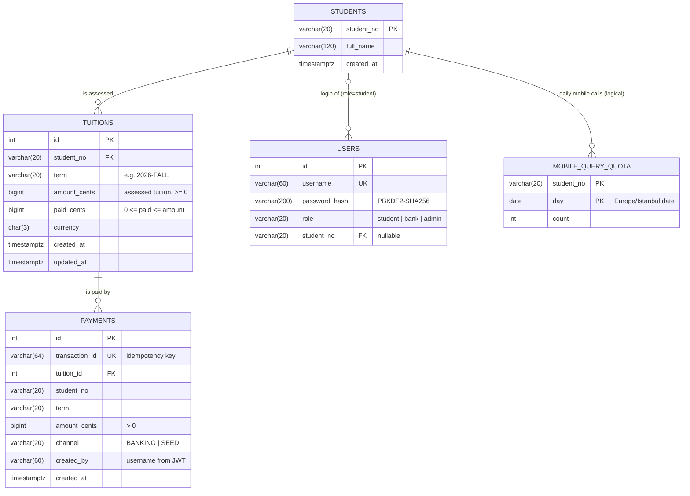

# ER / Data Model — Tuition database (PostgreSQL 16)

**Constraints / design notes**

| Rule | How it is enforced |
|---|---|
| One tuition per student per term | `UNIQUE (student_no, term)` on `tuitions` |
| Balance never negative | `CHECK (paid_cents <= amount_cents)`; API rejects payments above balance |
| Duplicate payments | `UNIQUE (transaction_id)` on `payments` + pre-check → `409 DUPLICATE_TRANSACTION` |
| Concurrent payments | `SELECT … FOR UPDATE` on the tuition row inside the payment transaction |
| Money precision | Stored as integer cents (`bigint`) → no floating-point rounding |
| Balance | `amount_cents − paid_cents` (denormalised `paid_cents` is updated in the same transaction as the payment insert) |
| Mobile 3/day rule | `mobile_query_quota (student_no, day)` counter (defence in depth behind the gateway's per-student counter) |
